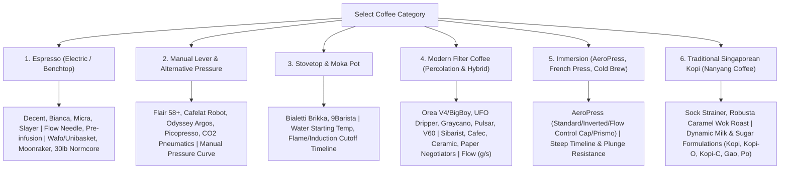
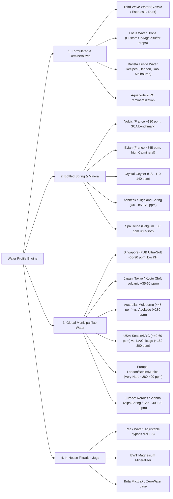
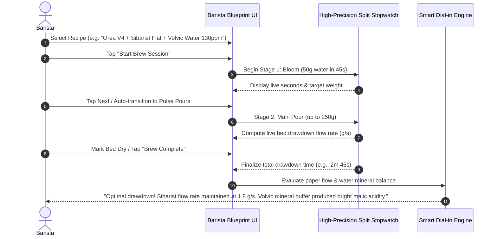

# Barista Blueprint: Dial-in & Coffee Recipe Vault
## System Architecture & Implementation Plan (2026 Equipment Ecosystem & Global Water Chemistry)

---

### 1. Coffee Category Taxonomy

The architecture features dedicated data schemas, workflow steps, and extraction timers for each distinct brewing discipline:

---

### 2. Comprehensive Water Chemistry & Global Water Profiling Engine

Water accounts for **98.5% of drip coffee** and **88–90% of espresso**. Mineral composition dictates extraction yield, perceived sweetness, acidity clarity, and crema formation:
- **TDS (Total Dissolved Solids)** in $ppm$ / $mg/L$
- **General Hardness (GH)** in $ppm$ $CaCO_3$ or $°dH$ (Total $Ca^{2+}$ and $Mg^{2+}$ ions; Magnesium accentuates fruit/floral notes, Calcium enhances heavy creamy body)
- **Carbonate Hardness / Alkalinity (KH)** in $ppm$ $CaCO_3$ or $°dH$ (Acid buffer capacity: low KH yields sparkling vibrant acidity; excessive KH mutes acidity into chalky bitterness)
- **pH level** and **Water Temperature** (°C / °F)

---

### 3. Comprehensive 2026 Specialty Gear & Tools Library

#### A. Modern Filter Drippers & Geometry
- **Orea**: *Orea V4 Modular* (interchangeable bases: Classic, Open, Fast, Apex), *Orea V3 MK2*, *Orea Big Boy*.
- **UFO Dripper**: *UFO Dripper* (ultra-wide, shallow bed geometry, hyper-fast uniform extraction).
- **Zero-Bypass & Hybrid Drippers**: *NextLevel Pulsar* (valve-controlled zero-bypass), *Tricolate*, *Hario Switch*, *Clever Dripper*.
- **Geometric Conical & Flat Drippers**: *Graycano* (cast aluminum Lava ribs), *April Dripper*, *Origami* (Air Resin & Ceramic), *Fellow Stagg [X/XF]*, *Timemore B75*, *Hario V60 (Plastic, Ceramic, Copper, Mugen)*, *Kalita Wave 155/185*, *Chemex (3, 6, 8 cup)*.
- **Porous Ceramic Micro-Filters**: *LOCA Ceramic Filter* (Arita-ware porous micro-filtration), *Cofil Fuji Ceramic*, *Kyuemon Ceramic Dripper*.

#### B. Filter Papers & Tooling (With Paper-to-Dripper Synergy)
- **Sibarist (Spain)**: *FAST Cone*, *FAST Flat*, *Sibarist UFO Papers*, *B3 & HYBRID discs*.
- **Orea Papers & Tooling**: *Orea Type 'A' (Fast) & Type 'B' (Balanced)*, *Orea Wave Papers*, *Orea Negotiator Tool* (dedicated tool to pleat and shape flat papers directly against dripper walls to eliminate bypass).
- **Cafec (Japan)**: *Cafec Abaca / Abaca+*, *T-90 Medium-Dark (fast drawdown)*, *T-83 Light Roast (high sweetness retention)*, *T-92 Dark Roast*.
- **Standard & Heavy Filtration**: *Chemex Bonded Filters*, *Kalita Wave 155/185*, *Hario V60 Tabbed (Japan/Europe) vs. Untabbed (Classic)*.
- **Dispersion & Water Agitation Tools**: *Melodrip* (zero-agitation shower tool), *Hario Drip-Assist*, *Gabi Master A*.

#### C. Espresso Machines & Lever Systems
- **Benchtop Electric Espresso**: *Decent Espresso (DE1PRO, DE1XL, Bengle)*, *Lelit Bianca V3 (needle valve paddle)*, *La Marzocco Linea Micra / Mini R*, *Slayer Espresso (needle valve pre-brew)*, *Sanremo YOU (paddle profiling)*, *E61 Flow Profiling rigs*.
- **Extraction Yield (EY %) & Refractometer Matrix**:
  - **Refractometer TDS Input**: Digital coffee refractometer integration (DiFluid R2 Extract, Atago PAL-Coffee, VST LAB Coffee III).
  - **Auto-Calculated Extraction Yield (EY %)**:
    $$\text{EY \%} = \frac{\text{Espresso Yield } (g) \times \text{Beverage TDS \%}}{\text{Dry Ground Dose } (g)}$$
  - **Extraction Target Zones**:
    - *Under-extracted*: $< 18.0\%$ (sour, grassy, quick finish)
    - *Specialty Balanced*: $18.5\% - 22.0\%$ (optimal sweetness, balanced acidity, lingering body)
    - *Modern High-Extraction*: $22.0\% - 25.5\%+$ (achieved with precision baskets like WAFO/Unibasket, low-fines grinders, bottom paper filters)
- **Manual Lever & Alternative Pressure**: *Flair 58 / 58+ / PRO 2*, *Cafelat Robot*, *Odyssey Espresso Argos*, *ROK EspressoGC*, *Wacaco Picopresso & Nanopresso*, *Staresso Mirage*, *CO2 Cartridge / Pneumatic Portable Machines*.
- **Stovetop Precision**: *9Barista* (9-bar twin boiler stovetop), *Bialetti Brikka* (weighted dual-valve crema), *Classic Bialetti Moka Express*.

#### D. Puck Preparation Suite (2026 Industry Standards)
- **Distribution & Needle Tools (WDT)**: *Subminimal Flick WDT* (retractable), *SworksDesign Billet WDT*, *Umikot / Planetary Gear WDT*, *Weber Workshops Moonraker & Blind Shaker*, *Normcore V2/V3*.
- **Tamping Systems**: *Normcore V4 Calibrated Spring Tamper (15 lb, 25 lb, 30 lb springs)*, *The Force Tamper* (automatic leveling impact), *Puqpress Q2 / M-Line Gen 5 digital electronic tamper*, *Pullman BigStep*.
- **Precision Baskets**: *Weber Workshops Unibasket*, *WAFO Baskets (Spirit, SOE, Classic)*, *Pesado HE%*, *Pullman 876*, *IMS Baristapro / E&B Lab Superfine*, *VST Precision*.
- **Puck Screens & Filtration Layers**: *SworksDesign Billet Puck Screen (0.2mm)*, *Normcore 0.8mm & 1.7mm titanium/mesh*, *Mish Chief Honeycomb*, *Bottom Basket Paper Filter Discs* (Cafec, Sibarist, Whatman).

---

### 4. Filter Coffee vs. Espresso: Variable Parity Matrix

| Dimension | Espresso & Lever Engine | Filter & Drip Engine (V60, Orea, UFO, Chemex, Pulsar) |
| :--- | :--- | :--- |
| **Water Recipe & TDS** | Target TDS, GH/KH ratio, boiler scale prevention rating | Target TDS, mineral accentuation (Mg for fruit/acidity, Ca for body) |
| **Tooling & Media** | Basket (Wafo/Unibasket/VST), Puck Screen (0.2/0.8mm), Paper Disc | Dripper (Orea V4, UFO, V60), Filter Paper (Sibarist FAST, Cafec Abaca, Ceramic), Negotiator |
| **Grind Size Metrics** | Grinder setting, burr geometry, micron estimate ($200–350\,\mu\text{m}$) | Grinder setting, clicks/microns ($500–950\,\mu\text{m}$), fines distribution profile |
| **Pre-Infusion / Bloom** | Pre-infusion seconds, pressure ($bar$), line vs pump | Bloom water weight ($g$), bloom duration, agitation method (swirl, stir, Melodrip) |
| **Immersion Control** | Continuous pressure vs lever dwell | Pure percolation vs Hybrid immersion valve toggle (Switch, Pulsar, Clever) |
| **Flow Dynamics** | Real-time extraction flow rate ($g/s = \text{Yield} \div \text{Time}$) | Bed drawdown speed ($g/s$), bypass resistance, paper-flow benchmarking |
| **Extraction Yield (EY %)** | $\text{EY \%} = \frac{\text{Yield } (g) \times \text{TDS \%}}{\text{Dose } (g)}$ (Refractometer 8%–12% TDS $\rightarrow$ 18%–25% EY) | Filter $\text{EY \%} = \frac{\text{Brew } (g) \times \text{TDS \%}}{\text{Dose } (g)}$ (1.2%–1.5% TDS $\rightarrow$ 19%–23% EY) |
| **Timeline Stages** | T1: Pre-infusion $\rightarrow$ T2: Peak ramp $\rightarrow$ T3: Flow decline | T1: Bloom $\rightarrow$ T2: Pulse 1 $\rightarrow$ T3: Pulse 2 $\rightarrow$ T4: Immersion steep $\rightarrow$ T5: Drawdown |
| **Sensory Feedback** | Sour/Channelling $\leftrightarrow$ Sweet/Crema $\leftrightarrow$ Bitter/Astringent | Bright acidity $\leftrightarrow$ Floral/Sweet balance $\leftrightarrow$ Dry astringency / Stalling |

---

### 5. Interactive Live Brew Station & Flow Rate Monitor

---

### 6. Implementation Roadmap

- [ ] **Phase 1: Project Scaffolding & Theme System**
  - Initialize Vite React (TypeScript) + Tailwind CSS + Lucide icons.
  - Setup rich dark/warm barista aesthetic with mobile-responsive layout for coffee bar stations.
- [ ] **Phase 2: Database & 2026 Gear + Global Water Preset Library**
  - Pre-load gear catalog: Orea (V3/V4/Big Boy), UFO Dripper, Sibarist FAST papers, Cafec series, LOCA/Cofil ceramic, NextLevel Pulsar, Decent, Flair 58+, 30lb Normcore tampers, Wafo/Unibasket, SworksDesign.
  - Pre-load water catalog: Third Wave Water, Lotus drops, Barista Hustle recipes, Volvic, Evian, Crystal Geyser, Ashbeck, and global municipal tap profiles (Singapore, Tokyo, Melbourne, Seattle, NYC, London, Berlin, Paris).
  - Custom gear & custom water profile builder (TDS, GH, KH, pH, temp).
  - Bean Cellar with roast date, degassing status, origin, and fermentation logging.
- [ ] **Phase 3: Recipe Vault & Multi-Category Engines**
  - Specialized recipe builders for:
    1. Benchtop Electric Espresso (flow control, pre-infusion, puck screens).
    2. Manual Levers & Alternative Pressure (Flair, Robot, Picopresso, CO2).
    3. Stovetop & Moka Pot (Brikka, 9Barista, flame cutoff).
    4. Modern Filter Coffee (Orea/UFO/V60, filter paper linkage, immersion toggles, grind microns).
    5. Immersion (AeroPress standard/inverted/prismo).
    6. Singaporean Kopi (condensed/evaporated milk & sugar formulation engine).
- [ ] **Phase 4: Live Brew Station & Dynamic Stopwatch**
  - Split timers (Bloom/Pre-infusion, Multi-Pour pulses, Drawdown, Plunge).
  - Real-time flow rate ($g/s$) monitor and paper flow index comparison.
- [ ] **Phase 5: Dial-in Diagnostic Advisor & Sensory Cupping**
  - Extraction diagnosis (Sour / Balanced / Bitter / Water buffer effect), automated adjustment recommendations.
  - JSON Backup, Export, and Recipe sharing.
