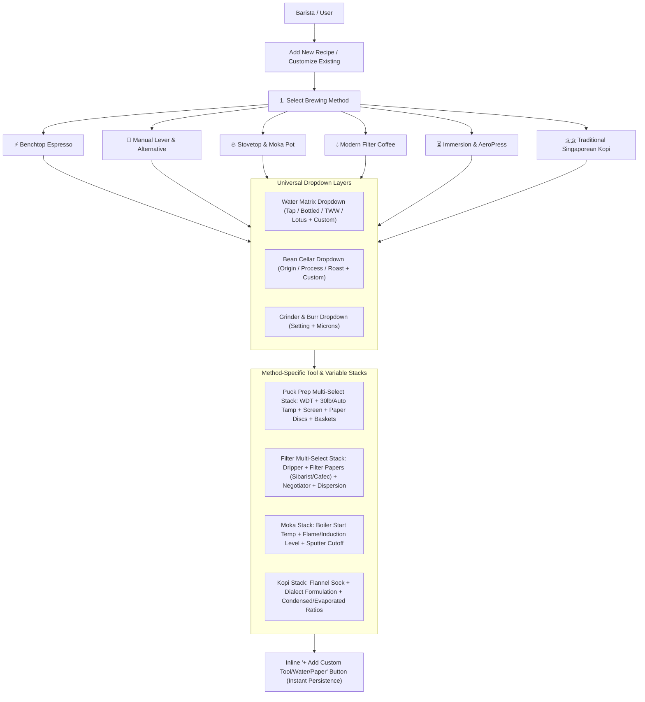
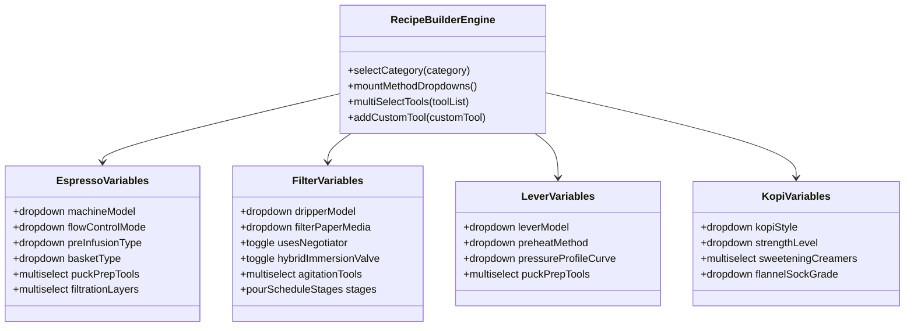
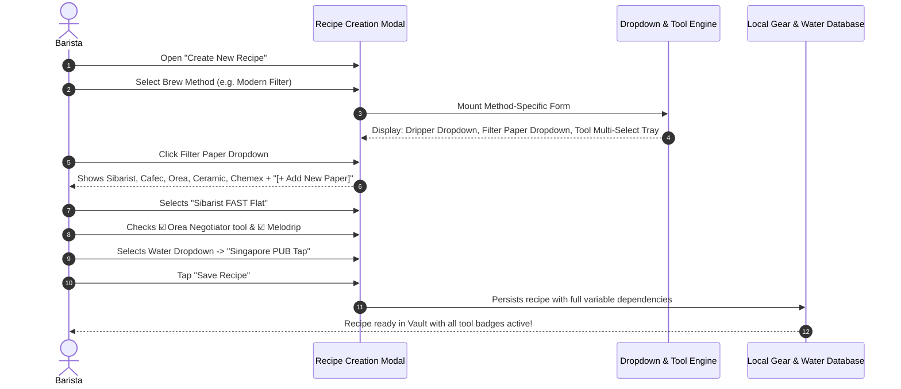

# Barista Blueprint: Dial-in & Coffee Recipe Vault
## System Architecture & Implementation Plan
### Expanded Planning: Granular Variable Dropdowns & Multi-Tool Recipe Customizer

---

### 1. Architectural Overview: Dynamic Variable & Dropdown Engine

Every coffee brewing method requires a customizable **New Recipe Builder** that balances quick preset selection with granular, multi-variable customization. Rather than static text fields, the system provides **categorized dropdowns, multi-select tool stacks, and inline "+ Add Custom Variable" inputs**.

---

### 2. Universal Variable Dropdown Selectors (Available Across All Methods)

Whenever a user creates or customizes a recipe in any method, they select from the following core dropdown matrices:

#### A. Water Chemistry Dropdown (`waterProfileId`)
Allows selecting existing profiles or entering custom parameters:
- **Municipal Tap Waters**:
  - `Singapore PUB Tap` (Ultra-Soft: 70 ppm TDS, 45 ppm GH, 35 ppm KH)
  - `Tokyo Snowmelt Tap` (Very Soft: 48 ppm TDS, 32 ppm GH, 24 ppm KH)
  - `Melbourne Specialty Baseline Tap` (Soft: 50 ppm TDS, 30 ppm GH, 25 ppm KH)
  - `Seattle Mountain Runoff Tap` (Soft: 42 ppm TDS, 28 ppm GH, 20 ppm KH)
  - `New York City Catskill Tap` (Soft-Med: 58 ppm TDS, 36 ppm GH, 28 ppm KH)
  - `London Thames Tap` (Very Hard Chalk: 320 ppm TDS, 260 ppm GH, 210 ppm KH)
  - `Berlin Groundwater Tap` (Very Hard: 360 ppm TDS, 280 ppm GH, 230 ppm KH)
- **Bottled Spring & Mineral Waters**:
  - `Volvic Natural Mineral` (France ~130 ppm TDS, SCA benchmark)
  - `Evian Natural Mineral` (France ~345 ppm TDS, High Calcium)
  - `Crystal Geyser Alpine Spring` (USA ~120 ppm TDS)
  - `Ashbeck Natural Spring` (UK ~85 ppm TDS)
  - `Spa Reine Natural Mineral` (Belgium ~33 ppm TDS ultra-soft)
- **Remineralized Recipes**:
  - `Third Wave Water - Classic Profile` (150 ppm TDS, 110 GH, 40 KH)
  - `Third Wave Water - Espresso Safe Profile` (150 ppm TDS, 85 GH, 65 KH)
  - `Lotus Water Drops - Bright & Juicy` (90 ppm TDS, 65 GH, 25 KH)
  - `Peak Water Precision Filter Jug` (Dial Setting 1.0 – 5.0)
- **Custom Water Action**:
  - `[+ Add Custom Water Source]`: Opens inline modal to log custom TDS ($ppm$), GH ($ppm$ Ca/Mg), KH ($ppm$ alkalinity buffer), and pH.

#### B. Coffee Bean Dropdown (`beanId`)
Pulls live from the user's **Bean Cellar**:
- Shows: `Bean Name` • `Roaster` • `Origin` • `Roast Level` • `Process (Washed/Natural/Anaerobic/Wok)` • `Days off roast`.
- Quick filter by Roast Degree (Light, Med-Light, Medium, Med-Dark, Dark, Nanyang Wok).
- Inline Action: `[+ Add New Bean to Cellar]`.

#### C. Grinder & Micron Size Dropdown
- **Grinder Model Dropdown**: Option-O Lagom (P64, P01, 01), Zerno Z1, Timemore Sculptor (064s, 078s), Fellow Ode Gen 2, Comandante C40 MK4, 1Zpresso (K-Ultra, J-Ultra, ZP6), Niche (Zero, Duo), Mazzer Philos, Baratza Encore ESP, or custom.
- **Grind Setting Input**: Dial/click setting (e.g. `1.4`, `5.1`, `24 clicks`).
- **Estimated Particle Micron Rating ($μm$)**: Numeric input with auto-suggested ranges ($200–350\,\mu\text{m}$ for espresso, $500–950\,\mu\text{m}$ for filter, $1000–1200\,\mu\text{m}$ for Kopi).

---

### 3. Method-Specific Variable Dropdowns & Multi-Select Tool Stacks

For each brewing discipline, the recipe creation interface dynamically mounts specialized variable dropdowns and multi-select tool trays:

#### Method 1: Benchtop Electric Espresso
- **Machine Selection Dropdown**:
  - `Decent Espresso (DE1PRO / DE1XL / Bengle)`
  - `Lelit Bianca V3 (Paddle Needle Valve)`
  - `La Marzocco Linea Micra / Mini R`
  - `Slayer Espresso (Needle Valve Pre-Brew)`
  - `Sanremo YOU (Digital Paddle Profiling)`
  - `E61 Heat Exchanger / Dual Boiler with Flow Profiling Kit`
  - `Single Boiler / Thermoblock`
  - `[+ Add Custom Espresso Machine]`
- **Extraction Control Dropdowns**:
  - *Flow Control Mode*: `Manual Needle Paddle` | `Automated Declining Flow Profile` | `Fixed Standard 9-Bar` | `Low-Pressure Turbo (6-Bar)`.
  - *Pre-Infusion Type*: `Passive Line-Pressure (2-3 bar)` | `Active Pump Pulsing` | `Zero Pre-infusion (Direct 9 bar)`.
- **Basket Model Dropdown**:
  - `WAFO Spirit (Laser-drilled high extraction)` | `Weber Workshops Unibasket (CNC Zero Deadzone)` | `Pesado HE%` | `Pullman 876` | `IMS Baristapro / E&B Superfine` | `VST Precision (15g, 18g, 20g, 22g)`.
- **Puck Preparation Multi-Select Tool Tray (Select as many as used)**:
  - ☑️ **Needle WDT Tool**: Dropdown selector (`Subminimal Flick 0.25mm` | `SworksDesign Billet 0.22mm` | `Umikot Planetary Gear` | `Weber Workshops Moonraker` | `Normcore V2 0.3mm`).
  - ☑️ **Surface Distributor**: Dropdown selector (`Wedge Leveler` | `OCD 3-Blade` | `Jack Leveler`).
  - ☑️ **Tamping System**: Dropdown selector (`Normcore V4 30lb Calibrated Spring` | `Normcore V4 25lb Spring` | `The Force Tamper Impact Leveling` | `Puqpress Digital Electronic Auto-Tamper` | `Traditional Flat Stainless Tamper`).
  - ☑️ **Top Puck Screen**: Dropdown selector (`SworksDesign 0.2mm Billet Screen` | `Normcore 0.8mm Titanium Mesh` | `Normcore 1.7mm Stainless Mesh` | `Mish Chief Honeycomb Screen`).
  - ☑️ **Bottom Basket Paper Filter**: Dropdown selector (`Sworks Bottom Paper Disc` | `Cafec 55mm Round Paper` | `Whatman Lab Grade 54mm Disc`).
  - ☑️ **Top Basket Paper Filter**: Toggle (`Yes / No`).
  - ☑️ **Pre-Tamp Agitation**: Dropdown selector (`Weber Workshops Blind Shaker` | `RDT Water Spritz`).
  - `[+ Add Custom Puck Prep Tool]`

---

#### Method 2: Manual Lever & Alternative Pressure
- **Device Model Dropdown**:
  - `Flair 58 / 58+ (Electric Heated Chamber)` | `Flair PRO 2` | `Flair Neo Flex`
  - `Cafelat Robot (Manual Dual Lever + Pressure Gauge)`
  - `Odyssey Espresso Argos (Spring & Direct Lever Hybrid)`
  - `ROK EspressoGC`
  - `Wacaco Picopresso (Handheld Precision Pump)` | `Nanopresso`
  - `Staresso Mirage`
  - `CO2 Cartridge / Pneumatic Portable Press`
  - `[+ Add Custom Lever/Portable Device]`
- **Chamber Pre-Heating Dropdown**:
  - `Built-in Electric PID (Level 1, 2, or 3)` | `Steam Chamber Pre-heat over Kettle` | `Boiling Water Dual Flush` | `No Pre-heat (Dark Roast)`.
- **Pressure Profiling Curve Dropdown**:
  - `Declining Flow Profile (3 bar pre-infusion → 8 bar peak → 5 bar declining finish)`
  - `Flat 6-Bar Turbo Profile`
  - `Traditional Lever Spring Profile (10 bar peak → natural spring decay)`
  - `Slayer-Style Extended Pre-Infusion (15s @ 2 bar → 9 bar finish)`
- **Puck Prep Multi-Select Tool Tray**:
  - Same comprehensive multi-tool tray as Benchtop Espresso (WDT, 30lb tamp, puck screens, paper discs).

---

#### Method 3: Stovetop & Moka Pot
- **Device Model Dropdown**:
  - `9Barista (Twin Boiler Jet-Engineered 9-Bar Stovetop)`
  - `Bialetti Brikka (Dual Weighted Crema Valve)`
  - `Classic Bialetti Moka Express (1, 3, 6 cup)`
  - `Alessi Pulcina / 9090`
  - `[+ Add Custom Stovetop Model]`
- **Boiler Water Starting Prep Dropdown**:
  - `Pre-Boiled Water (Reduces thermal exposure of grounds)`
  - `Room Temperature Water`
- **Heat Source & Intensity Dropdown**:
  - `Gas Burner (Low Flame with heat diffuser plate)`
  - `Induction Cooktop (400W – 800W setting)`
  - `Electric Ceramic Hotplate`
- **Extraction Cutoff Trigger Dropdown**:
  - `Blonding Transition (Remove from heat & quench base in cold water)`
  - `First Sputter Sound (Cutoff immediately)`
  - `Timed Extraction (25s from first emergence)`

---

#### Method 4: Modern Filter Coffee (Percolation & Hybrid Immersion)
- **Dripper Model Dropdown**:
  - *Orea Series*: `Orea V4 Modular (Apex Base)` | `Orea V4 (Fast Base)` | `Orea V4 (Open Base)` | `Orea V4 (Classic Base)` | `Orea V3 MK2` | `Orea Big Boy (Batch)`.
  - *UFO Series*: `UFO Dripper (Ultra-wide shallow flat bed)`.
  - *Zero-Bypass & Hybrid*: `NextLevel Pulsar (Zero-bypass valve)` | `Tricolate` | `Hario Switch 02/03` | `Clever Dripper`.
  - *Geometric Flat & Conical*: `Graycano (Lava Ribs)` | `April Glass/Plastic Dripper` | `Origami Air Resin / Ceramic` | `Fellow Stagg [X] / [XF]` | `Timemore B75` | `Hario V60 (Plastic 01/02, Ceramic, Copper, Mugen)` | `Kalita Wave 155/185 (Stainless Tsubame/Glass)` | `Chemex (3, 6, 8, 10 cup)`.
  - `[+ Add Custom Dripper]`
- **Filter Paper & Media Dropdown (Multi-Selectable)**:
  - *Sibarist (Spain)*: `Sibarist FAST Flat` | `Sibarist FAST Cone` | `Sibarist FAST UFO` | `Sibarist B3 / HYBRID`.
  - *Orea Specialty Papers*: `Orea Type 'A' (Fast)` | `Orea Type 'B' (Balanced)` | `Orea Wave 185 Papers`.
  - *Cafec (Japan)*: `Cafec Abaca` | `Cafec Abaca+` | `Cafec T-90 (Medium-Dark fast)` | `Cafec T-83 (Light roast dense)` | `Cafec T-92 (Dark)`.
  - *Porous Ceramic Micro-Filters*: `LOCA Arita Ceramic Filter` | `Cofil Fuji Porous Alumina` | `Kyuemon Ceramic Dripper`.
  - *Standard Papers*: `Chemex Bonded Circles / Squares` | `Kalita Wave Bleached / Unbleached` | `Hario V60 Tabbed (Japan/Europe)` | `Hario V60 Untabbed (Classic)`.
  - *Reusable Media*: `Flannel Cloth Filter` | `Stainless Steel Ultra-Fine Mesh`.
  - `[+ Add Custom Filter Paper / Medium]`
- **Filter Tooling Multi-Select Tray (Select as many as used)**:
  - ☑️ **Paper Shaper**: Dropdown (`Orea Negotiator (Zero Bypass)` | `3D Printed Pleater` | `Standard Rinse Fold`).
  - ☑️ **Dispersion & Agitation Tool**: Dropdown (`Melodrip (Collimated zero-agitation shower)` | `Hario Drip-Assist` | `Gabi Master A` | `Kettle Pour Only`).
  - ☑️ **Agitation Method**: Dropdown (`Gentle Swirl` | `Paddle Stir` | `Chopstick Star Agitation` | `Bed Tap`).
  - ☑️ **Immersion Valve Scheduling**: Toggle (`Open/Closed valve schedule for Switch/Pulsar`).
- **Pour Schedule Stage Builder**:
  - Add as many pour stages as required: `[Stage Name]`, `[Target Weight (g)]`, `[Start Second]`, `[Duration]`, `[Agitation Type]`, `[Valve Open/Closed]`.

---

#### Method 5: Immersion & Hybrid (AeroPress, French Press, Cold Brew)
- **AeroPress Orientation & Cap Dropdown**:
  - `Inverted AeroPress Setup` | `Standard Upright Setup`
  - `Fellow Prismo Pressure Valve` | `AeroPress Flow Control Filter Cap` | `Standard Hexagonal Cap`
- **Filter Medium Dropdown**:
  - `Single Paper Filter (Standard / Cafec Round)` | `Double Paper Filter` | `Ultra-Fine Metal Mesh Disc` | `Aesir Precision Filter Paper`.
- **Agitation & Steep Tools Multi-Select**:
  - ☑️ `AeroPress Paddle / Stirrer (Back-and-forth stir count: e.g. 10x)`
  - ☑️ `Plunge Speed Controller (Steady 30s plunge vs. rapid 10s)`
  - ☑️ `Hiss Cutoff (Stop immediately at hiss to avoid bitter astringency)`

---

#### Method 6: Traditional Singaporean Kopi (Nanyang Heritage)
- **Gear Setup Dropdown**:
  - `Long-Spout Stainless Steel Kettle + Traditional Flannel Sock Strainer (Kopi Bag)`
  - `Double Pot Sock Pull Station`
  - `Porcelain Floral Thick Cup & Saucer`
- **Nanyang Roast Dropdown**:
  - `Robusta Caramel Butter Wok Roast (Kim Guan Guan / Traditional)`
  - `Liberica / Robusta Artisan Wok Blend`
- **Dialect Order Formulation Dropdown**:
  - `Kopi` (Condensed milk + Evaporated milk + sugar)
  - `Kopi-O` (Black coffee + sugar)
  - `Kopi-O Kosong` (Pure black coffee, zero sugar)
  - `Kopi-C` (Fresh evaporated milk + sugar)
  - `Kopi-C Kosong` (Evaporated milk, no sugar)
  - `Kopi Gao` (Thick double strength grounds)
  - `Kopi Po` (Light / extra hot water dilution)
  - `Kopi Di-Lo` (Undiluted coffee essence straight from sock)
  - `Kopi Peng` (Iced over crushed ice)
- **Sweetener & Creamer Multi-Select Tray**:
  - ☑️ `Condensed Milk`: Brand dropdown (`F&N Sweetened Condensed` | `Carnation` | `Custom`) + Grams/tablespoons slider.
  - ☑️ `Evaporated Milk`: Brand dropdown (`Carnation Evaporated` | `Marigold Dawn` | `King of Kings`) + Grams/tablespoons slider.
  - ☑️ `Granulated Cane Sugar`: Grams / teaspoons slider.
  - ☑️ `Salted Butter Pat`: Dropdown (`Traditional Butter Melt in Cup - Kopi Gu You`).

---

### 4. Dynamic Variable Customization Flow

The recipe creation modal implements a **recursive component architecture**:

---

### 5. Implementation Task List for Variable Customizer

- [ ] **Task 1: Schema Updates for Dynamic Tool Stacking**
  - Update `Recipe` and `GearProfile` interfaces in `src/types/coffee.ts` to support dynamic arrays of `selectedTools: string[]` and `selectedMedia: string[]`.
- [ ] **Task 2: Modular Dropdown Components**
  - Build reusable `SelectWithAddCustom<T>` dropdown component supporting search, grouped presets, and instant `[+ Add Custom]` creation.
- [ ] **Task 3: Category-Specific Recipe Modal Builders**
  - Build specialized sub-panels in `RecipeModal.tsx` for Espresso (puck prep tray), Filter (papers, drippers, negotiator, multi-stage pour list), Moka (boiler prep & cutoff), and Kopi (dialect order & milk sliders).
- [ ] **Task 4: Interactive Tool Badge Previews**
  - Display interactive visual chips on recipe cards reflecting every single tool selected (e.g., `[WDT: 0.25mm]`, `[Tamper: 30lb Normcore]`, `[Screen: 0.2mm Billet]`, `[Paper: Sibarist FAST]`, `[Negotiator: Active]`).
