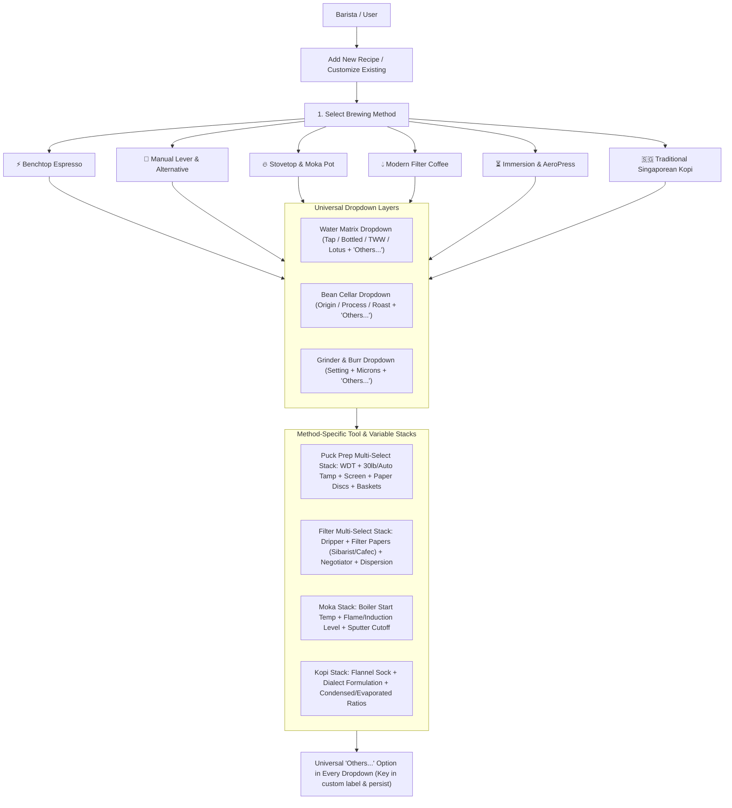
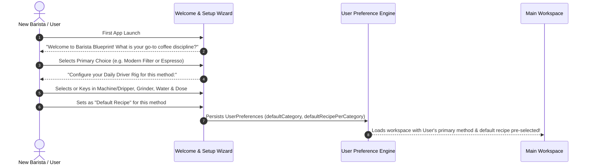
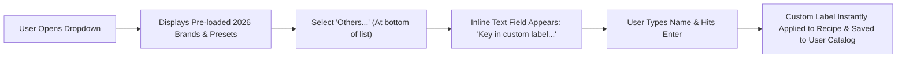
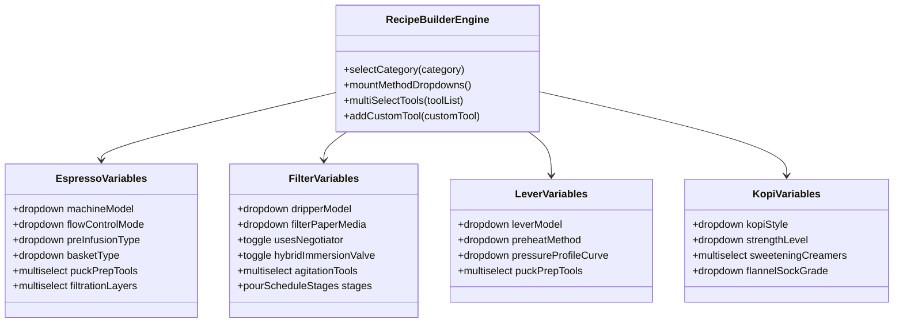
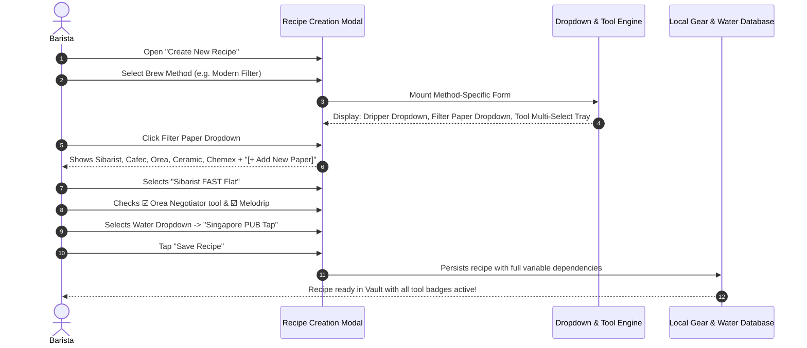
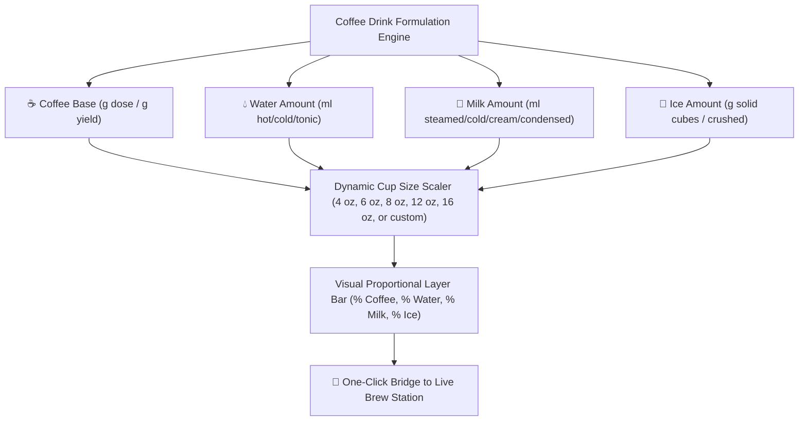

# Barista Blueprint: Dial-in & Coffee Recipe Vault
## System Architecture & Implementation Plan
### Expanded Planning: Granular Variable Dropdowns & Multi-Tool Recipe Customizer

---

### 1. Architectural Overview: Dynamic Variable & Dropdown Engine

Every coffee brewing method requires a customizable **New Recipe Builder** that balances quick preset selection with granular, multi-variable customization. Rather than static text fields, the system provides **categorized dropdowns, multi-select tool stacks, and inline "+ Add Custom Variable" inputs**.

---

### 2. First-Time User Experience (FTUX) & Default Method Engine

To eliminate friction on first launch, the application introduces an **Onboarding & Default Setup Flow**:

#### A. Onboarding & Default Rig Configuration
1. **Primary Method Selection**: User chooses their overall main choice (*Benchtop Espresso, Manual Lever, Modern Filter, Moka Pot, Immersion, or Singaporean Kopi*).
2. **Per-Method Default Rig**:
   - For *each* method the user chooses to customize, they can designate a **Default Go-To Recipe & Gear Rig**:
     - *Default Machine / Dripper*
     - *Default Grinder & Setting*
     - *Default Water Profile*
     - *Default Dose / Yield ratio*
3. **Instant 1-Tap Brew Launch**:
   - When the user launches the app or switches to a category tab, the interface automatically pre-loads their customized **Default Recipe** so they can start the brew stopwatch with 1 tap.
4. **Change Defaults Anytime**:
   - Every recipe card features a ⭐ **"Set as Default for [Category]"** button to seamlessly swap their daily driver.

---

### 3. Universal "Others..." Dropdown Architecture (Custom Label Key-In)

Across **every single variable dropdown** in the application, users are never restricted to pre-loaded options:

#### A. Fields Featuring the "Others..." Option:
- **Water Source**: Pre-loaded tap/bottled/TWW $\rightarrow$ Select `Others...` or click `Edit labels` $\rightarrow$ Key in e.g. *"Home Under-Sink RO System"*, *"ZeroWater 50ppm Remix"*, or *"My Village Well Spring"*.
- **Machine / Dripper**: Pre-loaded models $\rightarrow$ Select `Others...` or click `Edit labels` $\rightarrow$ Key in e.g. *"Custom Modded Gaggia"*, *"Cafelat Robot Barista Mod"*, or *"3D Printed Spiral Cone"*.
- **Grinder Model**: Pre-loaded grinders $\rightarrow$ Select `Others...` or click `Edit labels` $\rightarrow$ Key in e.g. *"Vintage Hand Mill"* or *"DF64 Gen 3"*.
- **Basket Brand & Size**: Pre-loaded Wafo/Unibasket/VST $\rightarrow$ Select `Others...` or click `Edit labels` $\rightarrow$ Key in e.g. *"Custom 21g Nano Basket"*.
- **Puck Preparation Tools**:
  - *WDT Needle Tool*: Pre-loaded $\rightarrow$ Select `Others...` or click `Edit labels` $\rightarrow$ Key in e.g. *"Acupuncture 0.2mm DIY Cork"*.
  - *Tamper*: Pre-loaded 30lb/Puqpress $\rightarrow$ Select `Others...` or click `Edit labels` $\rightarrow$ Key in e.g. *"Palm Convex 58.4mm"*.
  - *Puck Screen*: Pre-loaded billet/mesh $\rightarrow$ Select `Others...` or click `Edit labels` $\rightarrow$ Key in e.g. *"Laser Matrix Screen 0.5mm"*.
- **Filter Papers & Media**: Pre-loaded Sibarist/Cafec $\rightarrow$ Select `Others...` or click `Edit labels` $\rightarrow$ Key in e.g. *"Organic Unbleached Bamboo Paper"*.
- **Dispersion & Agitation**: Pre-loaded Melodrip/Drip-Assist $\rightarrow$ Select `Others...` or click `Edit labels` $\rightarrow$ Key in e.g. *"Spoon Dispersion Flow"*.
- **Bean Varietal & Process**: Pre-loaded $\rightarrow$ Select `Others...` or click `Edit labels` $\rightarrow$ Key in e.g. *"Eugenioides Yeast Inoculation"*.
- **Singaporean Kopi Creamer Brands**: Pre-loaded F&N/Carnation $\rightarrow$ Select `Others...` or click `Edit labels` $\rightarrow$ Key in e.g. *"FairPrice Gold Sweetened Creamer"*.

#### B. Technical Specification of "Edit labels" & `SmartDropdownWithOthers`
1. Every configuration dropdown renders an **"Edit labels"** button in its header row, always clickable regardless of whether a preset or custom variable is currently selected.
2. Clicking **"Edit labels"** pre-fills the input with the active selection, allowing users of minority or custom brands to tweak the label or type their custom brand name.
3. Upon saving (via Enter or Check), the custom label is saved to `customVariables` and persisted across sessions in `localStorage`.
4. In the Live Brew Station, a dedicated **Profile & Default Rig Selector** enables 1-tap switching between category daily defaults and pre-saved brew profiles.

---

### 4. Universal Variable Dropdown Selectors (Available Across All Methods)

Whenever a user creates or customizes a recipe in any method, they select from the following core dropdown matrices:

#### A. Water Chemistry Dropdown (`waterProfileId`)
Allows selecting existing profiles or entering custom parameters:
- **Municipal Tap Waters**:
  - `Singapore PUB Tap` (Ultra-Soft: 70 ppm TDS, 45 ppm GH, 35 ppm KH)
  - `Tokyo Snowmelt Tap` (Very Soft: 48 ppm TDS, 32 ppm GH, 24 ppm KH)
  - `Melbourne Specialty Baseline Tap` (Soft: 50 ppm TDS, 30 ppm GH, 25 ppm KH)
  - `Seattle Mountain Runoff Tap` (Soft: 42 ppm TDS, 28 ppm GH, 20 ppm KH)
  - `New York City Catskill Tap` (Soft-Med: 58 ppm TDS, 36 ppm GH, 28 ppm KH)
  - `London Thames Tap` (Very Hard Chalk: 320 ppm TDS, 260 ppm GH, 210 ppm KH)
  - `Berlin Groundwater Tap` (Very Hard: 360 ppm TDS, 280 ppm GH, 230 ppm KH)
- **Bottled Spring & Mineral Waters**:
  - `Volvic Natural Mineral` (France ~130 ppm TDS, SCA benchmark)
  - `Evian Natural Mineral` (France ~345 ppm TDS, High Calcium)
  - `Crystal Geyser Alpine Spring` (USA ~120 ppm TDS)
  - `Ashbeck Natural Spring` (UK ~85 ppm TDS)
  - `Spa Reine Natural Mineral` (Belgium ~33 ppm TDS ultra-soft)
- **Remineralized Recipes**:
  - `Third Wave Water - Classic Profile` (150 ppm TDS, 110 GH, 40 KH)
  - `Third Wave Water - Espresso Safe Profile` (150 ppm TDS, 85 GH, 65 KH)
  - `Lotus Water Drops - Bright & Juicy` (90 ppm TDS, 65 GH, 25 KH)
  - `Peak Water Precision Filter Jug` (Dial Setting 1.0 – 5.0)
- **Custom Water Action**:
  - `[+ Add Custom Water Source]`: Opens inline modal to log custom TDS ($ppm$), GH ($ppm$ Ca/Mg), KH ($ppm$ alkalinity buffer), and pH.

#### B. Coffee Bean Dropdown (`beanId`)
Pulls live from the user's **Bean Cellar**:
- Shows: `Bean Name` • `Roaster` • `Origin` • `Roast Level` • `Process (Washed/Natural/Anaerobic/Wok)` • `Days off roast`.
- Quick filter by Roast Degree (Light, Med-Light, Medium, Med-Dark, Dark, Nanyang Wok).
- Inline Action: `[+ Add New Bean to Cellar]`.

#### C. Grinder & Micron Size Dropdown
- **Grinder Model Dropdown**: Option-O Lagom (P64, P01, 01), Zerno Z1, Timemore Sculptor (064s, 078s), Fellow Ode Gen 2, Comandante C40 MK4, 1Zpresso (K-Ultra, J-Ultra, ZP6), Niche (Zero, Duo), Mazzer Philos, Baratza Encore ESP, or custom.
- **Grind Setting Input**: Dial/click setting (e.g. `1.4`, `5.1`, `24 clicks`).
- **Estimated Particle Micron Rating ($μm$)**: Numeric input with auto-suggested ranges ($200–350\,\mu\text{m}$ for espresso, $500–950\,\mu\text{m}$ for filter, $1000–1200\,\mu\text{m}$ for Kopi).

---

### 3. Method-Specific Variable Dropdowns & Multi-Select Tool Stacks

For each brewing discipline, the recipe creation interface dynamically mounts specialized variable dropdowns and multi-select tool trays:

#### Method 1: Benchtop Electric Espresso
- **Machine Selection Dropdown (Categorized by Heritage, Profiling & Global Origin)**:
  - *Artisan & Multi-Boiler Showcase*:
    - `Kees van der Westen (Netherlands)`: Spirit (Duette / Triplette), Speedster, Mirage, Slim Jim, Idrocompresso.
    - `Slayer Espresso (USA)`: Slayer Single Group (Needle-Valve Profiling), Slayer Steam LP, Slayer Steam EP.
    - `Synesso (USA)`: Synesso ES.1 (Single-Group Prosumer Profiling), MVP Hydra.
    - `Sanremo (Italy)`: Sanremo YOU (Volumetric & Paddle Pressure Profiling), CUBE, Cafe Racer.
  - *Italian Heritage & Commercial Prosumer Benchmark*:
    - `La Marzocco (Italy)`: Linea Micra, Linea Mini / Mini R, GS3 MP (Manual Paddle Profiling), GS3 AV, Strada (X / EP), Leva Luxury, KB90.
    - `Lelit (Italy)`: Bianca V3 (Manual Paddle Flow Control Needle), Mara X (Heat Exchanger PID), Elizabeth (Dual Boiler), Victoria, Anna.
    - `Rocket Espresso (Italy)`: R Cinquantotto (R58 Dual Boiler), Appartamento (TCA), Giotto Cronometro, Mozzafiato, Epica (Manual Lever with pressure profiling).
    - `ECM (Germany/Italy)`: Synchronika II (Dual Boiler + E61 Flow Profiling kit), Mechanika MAX, Puristika (Single Boiler with external glass reservoir & expansion flow valve).
    - `Profitec (Germany)`: Profitec Drive (Integrated Flow Control Dual Boiler), Pro 600, Pro 500, Profitec GO.
    - `Victoria Arduino / Nuova Simonelli (Italy)`: Eagle One Prima / Prima EXP (PureBrew Extraction), Oscar II, Black Eagle.
    - `Gaggia (Italy)`: Classic Pro / Classic EVO (including Gaggiuino Arduino Flow Profiling mod).
  - *Digital & Real-Time Flow Profiling*:
    - `Decent Espresso (Hong Kong/USA)`: DE1PRO, DE1XL, Bengle (Real-time pressure, flow, and temp feedback).
  - *Breville / Sage High-Value Ecosystem (Australia)*:
    - `Breville Dual Boiler (BES920XL)` (Including Slayer-mod needle valve routing).
    - `Breville Bambino / Bambino Plus` (ThermoJet 3-second instant heat-up).
    - `Breville Barista Express / Barista Express Impress`.
    - `Breville Barista Touch / Oracle Touch`.
  - *Leading Chinese & Asian Value-Engineered Brands (2024–2026)*:
    - `WPM / Welhome (Hong Kong/China)`: KD-310 / KD-330 (Triple Thermoblock with variable gear-pump flow profiling), KD-270.
    - `Gemilai (China)`: CRM3605 (Entry benchmark), CRM3007G (Rotary pump / PID), CRM3121A (Commercial dual boiler), CRM3200D.
    - `ITOP (China)`: ITOP 03, ITOP 40 Plus, ITOP Dual Thermoblock with digital PID.
    - `MiiCoffee / Turin (China/USA OEM)`: MiiCoffee Apex (Dual boiler PID with programmable pre-infusion), Turin Legato / Apex.
    - `HiBREW (China)`: HiBREW H10A (Commercial 58mm group with PID & adjustable pre-infusion), H10B, H7A (Dual boiler).
    - `Petrus (China)`: PE3888 (Commercial 58mm group), PE3899 (Dual thermoblock saturated group).
    - `Barsetto (China)`: Barsetto BAE02S, BAE-V1 (Dual boiler rotary pump).
  - `[+ Add Custom Espresso Machine]`
- **Extraction Control Dropdowns**:
  - *Flow Control Mode*: `Manual Needle Paddle` | `Automated Declining Flow Profile` | `Fixed Standard 9-Bar` | `Low-Pressure Turbo (6-Bar)`.
  - *Pre-Infusion Type*: `Passive Line-Pressure (2-3 bar)` | `Active Pump Pulsing` | `Zero Pre-infusion (Direct 9 bar)`.
- **Dedicated Espresso Basket Selection Suite (Brand, Size & Diameter)**:
  - **Basket Brand & Model Dropdown**:
    - *High-Extraction / Zero-Deadzone Series (2026 Standards)*:
      - `Weber Workshops Unibasket` (Single-piece billet CNC, edge-to-edge laser matrix)
      - `WAFO Spirit` (Hyper-dense laser perforated, ultra-high extraction)
      - `WAFO Classic` (Balanced flow rate)
      - `WAFO SOE` (Single-Origin Espresso optimization)
      - `WAFO Blonde` (High-clarity light roast specialty)
      - `Pesado HE% High Extraction Basket`
      - `Pullman 876 Precision Basket` (Maximized active surface area)
      - `MHW-3BOMBER DEX / Sniper High-Flow Basket`
      - `SworksDesign Billet Step Basket`
      - `Mish Chief Honeycomb Precision Basket`
    - *Specialty Precision Benchmark Series*:
      - `VST Precision (Ridgeless)`
      - `VST Precision (Ridged)`
      - `IMS Baristapro (Nanotech non-stick quartz coating)`
      - `IMS Competition Series (Curved bottom)`
      - `IMS Big Bang (Concentric graduated hole pattern)`
      - `E&B Lab Superfine (Integrated wire-mesh photo-etched membrane)`
      - `Decent Espresso Precision Basket`
      - `Hugh by Levercraft High-Flow Basket`
    - *Standard & OEM Commercial Series*:
      - `La Marzocco OEM (Strada Advanced Precision)`
      - `E61 Standard Commercial Double / Single`
      - `Breville / Sage OEM 54mm Double Wall / Single Wall`
      - `La Pavoni 51mm / 49mm Millenium Basket`
      - `[+ Add Custom Basket Brand & Model]`
  - **Basket Dose Capacity Dropdown (Gram Rating)**:
    - `Single Dose: 7g – 10g`
    - `Double Small: 14g – 16g`
    - `Double Standard: 17g – 19g (Classic 18g baseline)`
    - `Double Large: 20g – 22g (Modern 20g competition standard)`
    - `Triple: 22g – 24g`
    - `Max High-Volume: 24g – 26g+`
    - `[Custom Gram Capacity Input]`
  - **Basket Diameter & Portafilter Fit Dropdown**:
    - `58.5mm (Modern standard: E61, Decent, Bianca, Linea, Slayer, Flair 58)`
    - `54mm (Breville / Sage Bambino, Barista Express, Dual Boiler)`
    - `53mm (9Barista, La Spaziale)`
    - `51mm (La Pavoni Post-Millennium, Delonghi Dedica)`
    - `49mm (La Pavoni Pre-Millennium, Olympia Cremina)`
    - `45mm / Handheld (Picopresso, Nanopresso)`
  - **Hole Matrix & Geometry Profile**:
    - *Geometry*: `Straight Cylindrical Wall` (Full column uniform extraction) vs. `Tapered Conical` (Restricted lower surface area).
    - *Hole Distribution*: `Edge-to-Edge Laser Matrix` (Zero perimeter deadzones) vs. `Concentric Traditional Cluster` vs. `Big Bang Gradient Density`.
    - *Auto-Matched Tamper Base Recommendation*: System displays matched precision tamper size (e.g. $58.55\text{mm}$ edge-to-edge for Unibasket/Wafo/Pullman vs $53.3\text{mm}$ for 54mm Breville baskets).
- **Puck Preparation Multi-Select Tool Tray (Select as many as used)**:
  - ☑️ **Needle WDT Tool**: Dropdown selector (`Subminimal Flick 0.25mm` | `SworksDesign Billet 0.22mm` | `Umikot Planetary Gear` | `Weber Workshops Moonraker` | `Normcore V2 0.3mm`).
  - ☑️ **Surface Distributor**: Dropdown selector (`Wedge Leveler` | `OCD 3-Blade` | `Jack Leveler`).
  - ☑️ **Tamping System**: Dropdown selector (`Normcore V4 30lb Calibrated Spring` | `Normcore V4 25lb Spring` | `The Force Tamper Impact Leveling` | `Puqpress Digital Electronic Auto-Tamper` | `Traditional Flat Stainless Tamper`).
  - ☑️ **Top Puck Screen**: Dropdown selector (`SworksDesign 0.2mm Billet Screen` | `Normcore 0.8mm Titanium Mesh` | `Normcore 1.7mm Stainless Mesh` | `Mish Chief Honeycomb Screen`).
  - ☑️ **Bottom Basket Paper Filter**: Dropdown selector (`Sworks Bottom Paper Disc` | `Cafec 55mm Round Paper` | `Whatman Lab Grade 54mm Disc`).
  - ☑️ **Top Basket Paper Filter**: Toggle (`Yes / No`).
  - ☑️ **Pre-Tamp Agitation**: Dropdown selector (`Weber Workshops Blind Shaker` | `RDT Water Spritz`).
  - `[+ Add Custom Puck Prep Tool]`

---

#### Method 2: Manual Lever & Alternative Pressure
- **Device Model Dropdown**:
  - `Flair 58 / 58+ (Electric Heated Chamber)` | `Flair PRO 2` | `Flair Neo Flex`
  - `Cafelat Robot (Manual Dual Lever + Pressure Gauge)`
  - `Odyssey Espresso Argos (Spring & Direct Lever Hybrid)`
  - `ROK EspressoGC`
  - `Wacaco Picopresso (Handheld Precision Pump)` | `Nanopresso`
  - `Staresso Mirage`
  - `CO2 Cartridge / Pneumatic Portable Press`
  - `[+ Add Custom Lever/Portable Device]`
- **Chamber Pre-Heating Dropdown**:
  - `Built-in Electric PID (Level 1, 2, or 3)` | `Steam Chamber Pre-heat over Kettle` | `Boiling Water Dual Flush` | `No Pre-heat (Dark Roast)`.
- **Pressure Profiling Curve Dropdown**:
  - `Declining Flow Profile (3 bar pre-infusion → 8 bar peak → 5 bar declining finish)`
  - `Flat 6-Bar Turbo Profile`
  - `Traditional Lever Spring Profile (10 bar peak → natural spring decay)`
  - `Slayer-Style Extended Pre-Infusion (15s @ 2 bar → 9 bar finish)`
- **Puck Prep Multi-Select Tool Tray**:
  - Same comprehensive multi-tool tray as Benchtop Espresso (WDT, 30lb tamp, puck screens, paper discs).

---

#### Method 3: Stovetop & Moka Pot
- **Device Model Dropdown**:
  - `9Barista (Twin Boiler Jet-Engineered 9-Bar Stovetop)`
  - `Bialetti Brikka (Dual Weighted Crema Valve)`
  - `Classic Bialetti Moka Express (1, 3, 6 cup)`
  - `Alessi Pulcina / 9090`
  - `[+ Add Custom Stovetop Model]`
- **Boiler Water Starting Prep Dropdown**:
  - `Pre-Boiled Water (Reduces thermal exposure of grounds)`
  - `Room Temperature Water`
- **Heat Source & Intensity Dropdown**:
  - `Gas Burner (Low Flame with heat diffuser plate)`
  - `Induction Cooktop (400W – 800W setting)`
  - `Electric Ceramic Hotplate`
- **Extraction Cutoff Trigger Dropdown**:
  - `Blonding Transition (Remove from heat & quench base in cold water)`
  - `First Sputter Sound (Cutoff immediately)`
  - `Timed Extraction (25s from first emergence)`

---

#### Method 4: Modern Filter Coffee (Percolation & Hybrid Immersion)
- **Dripper Model Dropdown**:
  - *Orea Series*: `Orea V4 Modular (Apex Base)` | `Orea V4 (Fast Base)` | `Orea V4 (Open Base)` | `Orea V4 (Classic Base)` | `Orea V3 MK2` | `Orea Big Boy (Batch)`.
  - *UFO Series*: `UFO Dripper (Ultra-wide shallow flat bed)`.
  - *Zero-Bypass & Hybrid*: `NextLevel Pulsar (Zero-bypass valve)` | `Tricolate` | `Hario Switch 02/03` | `Clever Dripper`.
  - *Geometric Flat & Conical*: `Graycano (Lava Ribs)` | `April Glass/Plastic Dripper` | `Origami Air Resin / Ceramic` | `Fellow Stagg [X] / [XF]` | `Timemore B75` | `Hario V60 (Plastic 01/02, Ceramic, Copper, Mugen)` | `Kalita Wave 155/185 (Stainless Tsubame/Glass)` | `Chemex (3, 6, 8, 10 cup)`.
  - `[+ Add Custom Dripper]`
- **Filter Paper & Media Dropdown (Multi-Selectable)**:
  - *Sibarist (Spain)*: `Sibarist FAST Flat` | `Sibarist FAST Cone` | `Sibarist FAST UFO` | `Sibarist B3 / HYBRID`.
  - *Orea Specialty Papers*: `Orea Type 'A' (Fast)` | `Orea Type 'B' (Balanced)` | `Orea Wave 185 Papers`.
  - *Cafec (Japan)*: `Cafec Abaca` | `Cafec Abaca+` | `Cafec T-90 (Medium-Dark fast)` | `Cafec T-83 (Light roast dense)` | `Cafec T-92 (Dark)`.
  - *Porous Ceramic Micro-Filters*: `LOCA Arita Ceramic Filter` | `Cofil Fuji Porous Alumina` | `Kyuemon Ceramic Dripper`.
  - *Standard Papers*: `Chemex Bonded Circles / Squares` | `Kalita Wave Bleached / Unbleached` | `Hario V60 Tabbed (Japan/Europe)` | `Hario V60 Untabbed (Classic)`.
  - *Reusable Media*: `Flannel Cloth Filter` | `Stainless Steel Ultra-Fine Mesh`.
  - `[+ Add Custom Filter Paper / Medium]`
- **Filter Tooling Multi-Select Tray (Select as many as used)**:
  - ☑️ **Paper Shaper**: Dropdown (`Orea Negotiator (Zero Bypass)` | `3D Printed Pleater` | `Standard Rinse Fold`).
  - ☑️ **Dispersion & Agitation Tool**: Dropdown (`Melodrip (Collimated zero-agitation shower)` | `Hario Drip-Assist` | `Gabi Master A` | `Kettle Pour Only`).
  - ☑️ **Agitation Method**: Dropdown (`Gentle Swirl` | `Paddle Stir` | `Chopstick Star Agitation` | `Bed Tap`).
  - ☑️ **Immersion Valve Scheduling**: Toggle (`Open/Closed valve schedule for Switch/Pulsar`).
- **Pour Schedule Stage Builder**:
  - Add as many pour stages as required: `[Stage Name]`, `[Target Weight (g)]`, `[Start Second]`, `[Duration]`, `[Agitation Type]`, `[Valve Open/Closed]`.

---

#### Method 5: Immersion & Hybrid (AeroPress, French Press, Cold Brew)
- **AeroPress Orientation & Cap Dropdown**:
  - `Inverted AeroPress Setup` | `Standard Upright Setup`
  - `Fellow Prismo Pressure Valve` | `AeroPress Flow Control Filter Cap` | `Standard Hexagonal Cap`
- **Filter Medium Dropdown**:
  - `Single Paper Filter (Standard / Cafec Round)` | `Double Paper Filter` | `Ultra-Fine Metal Mesh Disc` | `Aesir Precision Filter Paper`.
- **Agitation & Steep Tools Multi-Select**:
  - ☑️ `AeroPress Paddle / Stirrer (Back-and-forth stir count: e.g. 10x)`
  - ☑️ `Plunge Speed Controller (Steady 30s plunge vs. rapid 10s)`
  - ☑️ `Hiss Cutoff (Stop immediately at hiss to avoid bitter astringency)`

---

#### Method 6: Traditional Singaporean Kopi (Nanyang Heritage)
- **Gear Setup Dropdown**:
  - `Long-Spout Stainless Steel Kettle + Traditional Flannel Sock Strainer (Kopi Bag)`
  - `Double Pot Sock Pull Station`
  - `Porcelain Floral Thick Cup & Saucer`
- **Nanyang Roast Dropdown**:
  - `Robusta Caramel Butter Wok Roast (Kim Guan Guan / Traditional)`
  - `Liberica / Robusta Artisan Wok Blend`
- **Dialect Order Formulation Dropdown**:
  - `Kopi` (Condensed milk + Evaporated milk + sugar)
  - `Kopi-O` (Black coffee + sugar)
  - `Kopi-O Kosong` (Pure black coffee, zero sugar)
  - `Kopi-C` (Fresh evaporated milk + sugar)
  - `Kopi-C Kosong` (Evaporated milk, no sugar)
  - `Kopi Gao` (Thick double strength grounds)
  - `Kopi Po` (Light / extra hot water dilution)
  - `Kopi Di-Lo` (Undiluted coffee essence straight from sock)
  - `Kopi Peng` (Iced over crushed ice)
- **Sweetener & Creamer Multi-Select Tray**:
  - ☑️ `Condensed Milk`: Brand dropdown (`F&N Sweetened Condensed` | `Carnation` | `Custom`) + Grams/tablespoons slider.
  - ☑️ `Evaporated Milk`: Brand dropdown (`Carnation Evaporated` | `Marigold Dawn` | `King of Kings`) + Grams/tablespoons slider.
  - ☑️ `Granulated Cane Sugar`: Grams / teaspoons slider.
  - ☑️ `Salted Butter Pat`: Dropdown (`Traditional Butter Melt in Cup - Kopi Gu You`).

---

### 4. Dynamic Variable Customization Flow

The recipe creation modal implements a **recursive component architecture**:

---

### 5. Implementation Task List for Variable Customizer

- [ ] **Task 1: Schema Updates for Dynamic Tool Stacking**
  - Update `Recipe` and `GearProfile` interfaces in `src/types/coffee.ts` to support dynamic arrays of `selectedTools: string[]` and `selectedMedia: string[]`.
- [ ] **Task 2: Modular Dropdown Components**
  - Build reusable `SelectWithAddCustom<T>` dropdown component supporting search, grouped presets, and instant `[+ Add Custom]` creation.
- [ ] **Task 3: Category-Specific Recipe Modal Builders**
  - Build specialized sub-panels in `RecipeModal.tsx` for Espresso (puck prep tray), Filter (papers, drippers, negotiator, multi-stage pour list), Moka (boiler prep & cutoff), and Kopi (dialect order & milk sliders).
- [x] **Task 4: Interactive Tool Badge Previews**
  - Display interactive visual chips on recipe cards reflecting every single tool selected (e.g., `[WDT: 0.25mm]`, `[Tamper: 30lb Normcore]`, `[Screen: 0.2mm Billet]`, `[Paper: Sibarist FAST]`, `[Negotiator: Active]`).

---

### 6. Drink Formulation & Ratio Engine: Comprehensive Drink Recipes

The application features a dedicated **Drink Lab (`DrinkLab.tsx`)** that catalogues 30+ classic, specialty, and heritage coffee drinks with mathematically precise liquid formulations across four core variables:

#### A. Global Drink Matrix with Exact Liquid Formulations

| Drink Name | Category | Glassware | Coffee Base | Water to Use | Milk / Cream to Use | Ice to Use | Additions / Sweeteners |
| :--- | :--- | :--- | :--- | :--- | :--- | :--- | :--- |
| **Espresso Solo** | Espresso Black | 60ml Demitasse | 9g dose → 18g yield | 0 ml (Zero bypass) | 0 ml | 0 g (Hot 65°C) | None |
| **Espresso Doppio** | Espresso Black | 90ml Demitasse | 18g dose → 36g yield | 0 ml (Zero bypass) | 0 ml | 0 g (Hot 65°C) | Sparkling water side |
| **Ristretto** | Espresso Black | 60ml Demitasse | 18g dose → 22g yield | 0 ml | 0 ml | 0 g | Restricted sweet cut |
| **Lungo** | Espresso Black | 120ml Ceramic | 18g dose → 54g yield | 0 ml | 0 ml | 0 g | Extended extraction |
| **Caffè Americano** | Espresso Black | 240ml Ceramic | 18g dose → 36g yield | 160 ml hot water (92°C) | 0 ml | 0 g | Water poured into espresso |
| **Long Black** | Espresso Black | 180ml Tulip | 18g dose → 36g yield | 140 ml hot water (90°C) | 0 ml | 0 g | Espresso floated on water (crema preserved) |
| **Espresso Macchiato** | Espresso Milk | 75ml Demitasse | 18g dose → 36g yield | 0 ml | 20 ml silky microfoam | 0 g | Foam dollop in center |
| **Cortado / Gibraltar**| Espresso Milk | 135ml Gibraltar | 18g dose → 36g yield | 0 ml | 44 ml warm steamed milk (58°C) | 0 g | 1:1 balance, 2mm microfoam |
| **Piccolo Latte** | Espresso Milk | 90ml Picardie | 18g dose → 20g ristretto | 0 ml | 70 ml silky microfoam (62°C) | 0 g | 1:2 ratio in 90ml glass |
| **Flat White** | Espresso Milk | 160ml Tulip | 18g dose → 36g yield | 0 ml | 124 ml glossy wet microfoam (60°C) | 0 g | Flat 2mm microfoam integration |
| **Traditional Cappuccino**| Espresso Milk | 180ml Round Cup | 18g dose → 36g yield | 0 ml | 65ml steamed + 45ml dense foam | 0 g | 1:1:1 thirds + cocoa dusting |
| **Caffè Latte** | Espresso Milk | 280ml Tumbler | 18g dose → 36g yield | 0 ml | 220 ml steamed milk (65°C) | 0 g | 8mm microfoam cap |
| **Caffè Mocha** | Espresso Milk | 300ml Glass Mug | 18g dose → 36g yield | 0 ml | 180 ml steamed whole milk | 0 g | 30g dark chocolate ganache + 20g cream |
| **Spanish Latte / Bombón**| Espresso Milk | 220ml Clear Glass | 18g dose → 36g yield | 0 ml | 120 ml steamed whole milk | 0 g | 35g sweetened condensed milk (bottom layer) |
| **Café au Lait** | Espresso Milk | 250ml French Bowl | 15g dose → 120g filter | 0 ml | 120 ml hot steamed milk (68°C) | 0 g | 1:1 French press & steamed milk |
| **Iced Americano** | Iced & Chilled | 350ml Highball | 18g dose → 36g yield | 120 ml cold filtered water | 0 ml | 150 g dense ice cubes (5-6 cubes) | Clean, zero-calorie cooler |
| **Iced Caffè Latte** | Iced & Chilled | 350ml Tumbler | 18g dose → 36g yield | 0 ml | 160 ml cold whole/oat milk (4°C) | 130 g ice cubes | Two-toned iced cascade |
| **Dirty Coffee** | Iced & Chilled | 180ml Rocks Glass | 18g dose → 36g hot espresso | 0 ml | 120 ml chilled heavy milk (70% milk, 30% cream at 2°C) | 0 g (Zero ice! Chilled by glass) | Thermal contrast layering |
| **Espresso Tonic** | Iced & Chilled | 350ml Highball | 18g dose → 36g yield | 140 ml chilled tonic water | 0 ml | 130 g clear ice cubes | 1 orange wedge + quinine botanicals |
| **Caffè Shakerato** | Iced & Chilled | 150ml Coupe Glass | 18g dose → 36g yield | 0 ml | 0 ml | 110 g ice in shaker (strained out) | 10 ml simple syrup, shaken 15s |
| **Freddo Espresso** | Iced & Chilled | 300ml Highball | 18g dose → 40g yield | 0 ml | 0 ml | 60g whipped with mixer + 90g fresh ice | Greek creamy iced espresso |
| **Freddo Cappuccino** | Iced & Chilled | 350ml Tumbler | 18g dose → 40g whipped | 0 ml | 80 ml frothed cold low-fat foam (Afrogala) | 140 g ice cubes total | Cinnamon dusting over cold foam |
| **Japanese Flash Brew** | Iced & Chilled | 350ml Server | 20g dose → 180ml hot brew | 180 ml hot water (93°C) | 0 ml | 120 g ice cubes in carafe (melts to 300ml) | 60:40 water-to-ice flash cooling |
| **Classic Cold Brew** | Iced & Chilled | 300ml Old Fashioned | 20g dose → 120ml concentrate | 60 ml cold water to dilute | 0 ml | 110 g ice cubes | 16-24 hr steep, low acid |
| **Nitro Cold Brew** | Iced & Chilled | 300ml Craft Pint | 22g dose → 240ml cold brew | 0 ml | 0 ml (Microbubbles create creaminess) | 0 g (Served cold from tap at 3°C) | Pressurized $N_2$ cascade |
| **Affogato al Caffè** | Iced & Chilled | 150ml Coupe Glass | 18g dose → 36g hot espresso | 0 ml | 0 ml | 0 g | 70g (1 large scoop) vanilla gelato |
| **Singapore Kopi (Hot)** | Traditional Heritage | 200ml Kopitiam Cup | 18g dose → 110ml sock essence | 40 ml boiling water | 25g condensed milk + 15g evaporated milk | 0 g | Caramelized wok-roast Robusta |
| **Singapore Kopi Peng** | Traditional Heritage | 350ml Kopitiam Mug | 22g dose → 110ml sock essence | 20 ml hot water | 35g condensed milk + 20g evaporated milk | 160 g crushed ice | Sweetened to withstand ice melt |
| **Singapore Kopi-C Peng**| Traditional Heritage | 350ml Kopitiam Mug | 20g dose → 110ml sock essence | 20 ml hot water | 40g evaporated milk (Carnation) | 150 g crushed ice | 14g raw cane sugar |
| **Singapore Kopi-O Peng**| Traditional Heritage | 350ml Kopitiam Mug | 20g dose → 130ml sock essence | 30 ml hot water | 0 ml (Zero dairy) | 150 g crushed ice | 16g sugar stirred into hot essence |
| **Vietnamese Cà Phê Sữa Đá** | Traditional Heritage | 250ml Glass | 20g Robusta → 65ml Phin drip | 0 ml (All 85ml water inside Phin) | 35g sweetened condensed milk | 140 g crushed ice | Dark roast gravity drip |
| **Turkish Coffee** | Traditional Heritage | 70ml Fincan Cup | 8g ultra-fine → 70ml brew | 70 ml cold water into cezve pot | 0 ml | 0 g | 5g sugar + cardamom simmered |
| **Viennese Einspänner** | Specialty Fusion | 200ml Footed Glass | 18g dose → 36g yield | 35 ml hot water | 65g chilled heavy cream whipped to soft peaks | 0 g | Powdered sugar + cocoa dust |
| **Traditional Irish Coffee**| Specialty Fusion | 240ml Footed Glass | 16g dose → 120ml drip coffee | 0 ml | 45 ml chilled heavy cream lightly whipped | 0 g | 40 ml Irish Whiskey + 10g brown sugar |
| **Portuguese Mazagran**| Iced & Chilled | 350ml Highball | 18g dose → 36g yield | 80 ml chilled sparkling water | 0 ml | 130 g ice cubes | 25 ml lemon juice + 15 ml syrup |

#### B. Dynamic Cup Size Scaling Formula
When the user selects an alternative serving volume ($V_{\text{target}}$) or multiplier ($M = V_{\text{target}} / V_{\text{default}}$):
$$\text{Water}_{\text{scaled}} = \text{round}(\text{Water}_{\text{default}} \times M)$$
$$\text{Milk}_{\text{scaled}} = \text{round}(\text{Milk}_{\text{default}} \times M)$$
$$\text{Ice}_{\text{scaled}} = \text{round}(\text{Ice}_{\text{default}} \times M)$$
$$\text{Coffee Yield}_{\text{scaled}} = \text{round}(\text{Coffee Yield}_{\text{default}} \times M)$$
$$\text{Sweeteners}_{\text{scaled}} = \text{round}(\text{Sweeteners}_{\text{default}} \times M)$$
This guarantees mathematical accuracy whether brewing a 4 oz Cortado or a 16 oz Venti Iced Latte.

